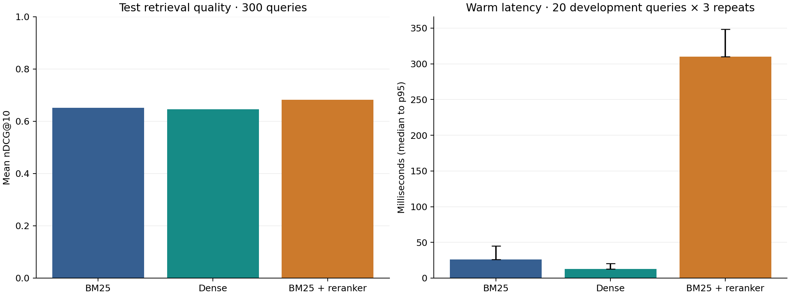

# Semantic Search: Retrieval Quality vs. Speed

**Joe Williams · Completed Colab experiment · November 18, 2026**

Does reranking improve evidence retrieval enough to justify its additional query time? This experiment compares BM25, dense retrieval, and BM25 followed by a cross-encoder on BEIR SciFact.

## Recorded results

Quality was evaluated on **all 300 official test queries** against **5,183 documents**. Each query receives
equal weight. Higher quality scores are better; these retrieval metrics are not classification accuracy.

| Pipeline | nDCG@10 | MRR@10 | Recall@5 | Recall@10 | Recall@50 |
|---|---:|---:|---:|---:|---:|
| BM25 | 0.6519 | 0.6186 | 0.7284 | 0.7740 | 0.8657 |
| Dense embeddings | 0.6451 | 0.6047 | 0.7379 | 0.7833 | 0.8920 |
| BM25 + reranker | 0.6818 | 0.6529 | 0.7301 | 0.8029 | 0.8657 |

Warm latency was measured separately on **20 development queries × 3 repeats per pipeline**, with randomized
trial order and synchronized GPU timing. Lower time is better; p95 is a latency percentile, not an uncertainty interval.

| Pipeline | Median (ms) | p95 (ms) | Trials |
|---|---:|---:|---:|
| BM25 | 26.32 | 44.93 | 60 |
| Dense embeddings | 12.74 | 20.23 | 60 |
| BM25 + reranker | 310.25 | 348.62 | 60 |

Reranking produced the highest test nDCG@10, improving over BM25 by **0.0299**, while requiring
**11.79×** its median query time. Dense retrieval was fastest, but its nDCG@10 was **0.0068 lower**
than BM25's. Dense retrieval had the highest Recall@5 and Recall@50. No pipeline dominates every quality measure.

BM25 and BM25 + reranker have identical Recall@50 (**0.8657**) because they contain exactly the same 50 candidates.
Reranking changes order; it cannot add a missed document. Its mean gain includes **60 improved, 47 worsened,
and 193 tied** test queries on nDCG@10.



## Uncertainty and practical interpretation

Intervals use 2,000 paired query-bootstrap resamples with seed 2026.

| Comparison | Mean nDCG@10 change | Paired 95% interval | Improved / worsened / tied queries |
|---|---:|---|---|
| Dense embeddings minus BM25 | -0.0068 | [-0.0454, +0.0308] | 70 / 71 / 159 |
| BM25 + reranker minus BM25 | +0.0299 | [+0.0014, +0.0578] | 60 / 47 / 193 |
| BM25 + reranker minus Dense embeddings | +0.0367 | [+0.0021, +0.0739] | 78 / 57 / 165 |

The dense-versus-BM25 interval spans zero. The two reranking intervals are above zero in this recorded
bootstrap analysis, with lower bounds close to zero. They support a conditional descriptive comparison,
not a guarantee across datasets or a claim that reranking helps every query.

For this run, dense retrieval offers the lowest warm latency; reranking offers the highest primary
retrieval score at substantially greater query time. A deployment choice would require a latency budget,
the cost of missed evidence, and representative target-domain queries.

## Experiment and code

- **BM25:** fixed Unicode word tokenization with case folding; `k1=1.5`, `b=0.75`; score all documents.
- **Dense retrieval:** `sentence-transformers/all-MiniLM-L6-v2`; unit-normalized 384-dimensional vectors; exact cosine search over the entire matrix.
- **Reranking:** `cross-encoder/ms-marco-MiniLM-L6-v2`; score and reorder BM25's top 50. Raw logits are not relevance probabilities.
- **Protocol:** three fixed configurations, no fitting or fine-tuning, 50 seeded development queries, and all 300 official test queries. No method was tuned on test results.
- **Timing:** each request recomputes query work; the reranked path includes BM25 retrieval. Models and corpus representations are warm, with no query/result cache.

Corpus embedding took **18.14 seconds** and BM25 tokenization/indexing **0.83 seconds**. Neural model loading,
including any downloads, took **6.33 seconds**. These distinct setup components are not per-query latency.
The dense vector matrix occupies **7,961,088 bytes (7.59 MiB)**; that is not total process or GPU memory.

Source revisions and configurations are fixed in `config.json`. The actual run used Python 3.13.16,
PyTorch 2.14.1+cu130, Sentence Transformers 5.1.2, and Transformers 4.57.6 on a Tesla T4.
All reported values come from this run; small preparation checks are recorded separately.

The source audit found no duplicate normalized documents and two normalized query strings shared across
the complete official train/test splits. The development sampler excludes such strings. All official
test IDs are retained. The 181 shared relevant document IDs across train/test are shared retrieval targets,
not overlapping query IDs. No semantic-duplicate or pretraining-contamination audit is claimed.

See [CODE_WALKTHROUGH.md](CODE_WALKTHROUGH.md) for explanations of the ranking code, metrics, timing,
and trade-offs, and the executed notebook for the full experiment and outputs.

## Selected development errors

Five development queries were inspected to illustrate gains, ordering errors, and candidate misses.
They are selected examples, not a random sample of causes. Observations and reference-document ranks
are in [analysis/error_analysis.csv](analysis/error_analysis.csv). The original 50-row worksheet is preserved unchanged.
No relevance labels were edited and no independent annotation-reliability study was performed.

| Development query | Relevant-document ranks: BM25 → reranked (dense) | Observation |
|---|---|---|
| 1139 | 9 → 1 (2) | Reranking promoted the trial abstract relevant to the information need. |
| 498 | 7 → 1 (1) | Both neural pipelines found relevant counterevidence; relevance does not imply the query claim is true. |
| 391 | 3 → 14 (2) | Reranking moved a retrieved relevant document out of the top 10. |
| 310 | 5 → 13 (>50) | A reranker ordering error and a dense candidate miss on the same query. |
| 1109 | >50 → >50 (>50), for both relevant documents | Both initial retrieval methods missed the judged documents; reordering BM25's pool could not recover them. |

These rank changes are observable. Topical overlap and input truncation are possible contributors,
but this experiment does not establish their causal role in an individual error.

## Limits of the comparison

The dense encoder uses at most **256 tokens** and truncated **3,681 of 5,183 documents (71.02%)**.
Reranking uses at most **512 tokens per query/document pair** and truncated **2,037 of 15,000 test pairs (13.58%)**
and **289 of 2,500 development pairs (11.56%)**. No evaluated dense query was truncated.
BM25 uses full title-plus-abstract text. These are comparisons of the declared pipelines,
not an isolated causal test of keyword versus neural architectures or the effect of truncation.

BM25 runs on CPU through `rank-bm25`; neural inference uses a Tesla T4, with dense vector comparison on CPU.
The dense pipeline's observed speed advantage is specific to this implementation, corpus, and hardware.
Warm timings exclude downloads, loading, and document indexing, and do not establish concurrent-user
throughput or production latency. Twenty queries repeated three times are not 60 independent queries.

The benchmark's judgments may be incomplete: unjudged documents score as nonrelevant without proving
they are irrelevant. Model pretraining exposure was not audited. Bootstrap intervals describe query
sampling conditional on this corpus, models, and labels; they exclude annotation uncertainty, hardware
variation, and domain shift. The three comparisons are descriptive and not adjusted for multiple testing.
No generated-answer accuracy, claim truth, or performance on policy/maritime documents was measured.

## Inspect and reproduce

1. Open [Semantic_Search_Evaluation.ipynb](Semantic_Search_Evaluation.ipynb) to inspect all 13 executed code cells, outputs, and added interpretation.
2. Inspect the **35 original result files** in [results/search_20261118T185027Z-4f8afe](results/search_20261118T185027Z-4f8afe). They are preserved byte-for-byte from the supplied archive.
3. Verify the saved evidence without models or a GPU:

```bash
pip install numpy
python scripts/verify_results.py results/search_20261118T185027Z-4f8afe
```

Verification passed for **1,050 query-method rankings**, **180 timing trials**, aggregate/per-query metrics,
CSV tables, paired bootstrap calculations, candidate membership, and hashes. All saved qrels, document IDs,
and source hashes match the pinned benchmark, and development/latency sampling was reproduced.
An independent scikit-learn nDCG calculation matched all 1,050 rankings.
See [analysis/verification.json](analysis/verification.json).

The executed notebook's numerical outputs were retained. Colab-only progress/download widgets and
unsupported stream metadata were removed for GitHub rendering. Explanatory Markdown was updated after
execution; the code was unchanged. Verification did not repeat model inference or establish annotation reliability.

For a new run, open a separate notebook copy in a fresh Colab T4 runtime and choose **Run all**.
The original source setup remains enabled and creates a new result directory. No API key or paid
inference API is required. Use `requirements.txt` for local setup; recorded versions are in the result
folder's `environment.json`. Previous test results are now visible, so any later tuning on this benchmark
must acknowledge that reuse. Corpus text and model weights are downloaded separately, not bundled.

## Sources and license

This project extends Chapter 8 of *Hands-On Large Language Models* by Jay Alammar and Maarten Grootendorst.
See [ATTRIBUTION.md](ATTRIBUTION.md), the retained upstream [LICENSE](LICENSE), and the result directory's
`DATA_SOURCES.md`. Data-derived IDs/judgments retain their source terms; the code license does not relicense them.
